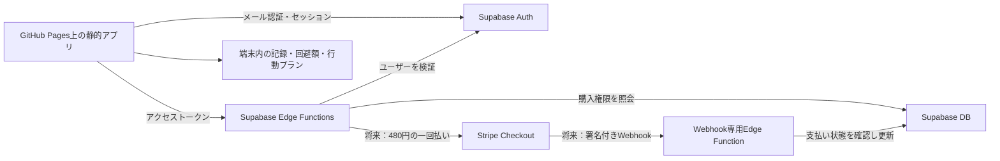

# ハズレの記憶 PLUS：認証・購入権限基盤設計

設計対象：GitHub Pages、販売予定480円（税込・買い切り）。月額料金・自動更新なし。

今回は価格表示と設計書のみ変更する。プロジェクト作成、サービス接続、ログイン実装、Stripe連携、公開設定変更は未実施。SQL/API/設定は以下の実装案であり、実行していない。設定値・最新料金・サービス設定は未確認で、推測して埋めない。

## 1. 現在の構成と変更境界

フロントはHTML/CSS/JavaScriptモジュール。フレームワークとビルド処理はなし。bootstrap.mjsは復元ジャーナルを確認してからFREEとPLUSデモを起動する。FREE、回避額、行動プランの独立localStorageキーと一括バックアップv1を維持する。

plus-access.mjsの開発用providerは getAccess() と subscribe(listener) を公開し、分析・回避額・行動プランUIに注入している。本番は同じインターフェースのサーバー確認providerへ置き換える。FREE本体、5秒演出、ランダム表示、既存記録の意味を変更しない。

認証エラーでアプリ全体をinertにしない。現在の一括復元回復失敗によるデータ保護の編集停止と、将来の認証・購入確認失敗は別の状態である。

## 2. 推奨アーキテクチャ



Supabaseはログイン用メールアドレス・アカウントIDと購入権限、必要最小限の決済履歴を管理する。衝動・成功記録、言葉、金額・メモ、行動プランは送信しない。権限確認APIにこれらのデータを添付しない。

ブラウザはSupabaseの公開キーだけを持つ。service_role/サーバーsecret key、Stripe秘密鍵、Webhook secretはEdge Functionsの秘密設定にのみ置く。GitHub Pagesでは秘密環境変数を保持して処理することはできない。

## 3. メール認証

### 推奨：メールのワンタイムコード（OTP）

初期版はパスワードを持たない認証を推奨する。登録・ログインを分けて表示し、メールに届くワンタイムコードを入力する。メールテンプレートをコード認証用に設定する。実装時には採用SDK・プロジェクト設定でAPIとテンプレートの組み合わせを確認する。

1. 登録：メールアドレス入力 → signInWithOtp（新規作成を許可）→ メール受信 → verifyOtp → Authのユーザー・セッション確立。
2. ログイン：同様に送信するが、新規作成を許可しない。既存利用者が間違ったメールで新アカウントを作ってしまうことを避ける。
3. 有効期限切れ・誤コード・再送制限を案内する。送信失敗からアカウントの存在を他人に断定させない文言にする。
4. ログアウト：Authセッションを終了し、PLUS権限キャッシュを即時無効化する。端末内の利用者データは削除しない。

パスワードがないため再設定は不要。同じメールで再認証する。メールを失った場合のサポート方針は別途決める。ログインメール変更は、確認済みユーザーIDを保った正規のメール変更フローで扱う。購入をメール文字列だけで紐付けない。

### マジックリンクの選択肢

メール内のリンクをクリックして認証する方式も採用可能。ただし、GitHub Pagesのリポジトリ配下URLを正確に許可し、実在する auth-callback.html を用意する。ルートの架空APIパスやSPAの存在しないURLに戻さない。

PKCEでは認証要求を始めたブラウザの検証情報が必要になり、別ブラウザ・別端末でメールリンクを開くと失敗する場合がある。端末をまたぐ復元では、その端末で改めて認証を開始する。初期版はコード方式にして、この混乱を減らす。

メールリンク/コード以外にパスワード方式を選ぶなら、メール確認付き登録、パスワードログイン、resetPasswordForEmailから専用戻り先でのパスワード更新を追加する。本計画では方式を混在させず、先にメールOTPを実装する。

## 4. テーブル案

auth.usersはSupabase Authが管理する。独自のパスワードや認証トークンをテーブルへ保存しない。

| テーブル | 主な列 | 用途 |
|---|---|---|
| public.plus_entitlements | user_id、product_code、status、granted_at、updated_at | 現在の利用権。ユーザー＋商品で一意 |
| public.plus_purchases | id、user_id、product_code、provider、checkout_session_id、payment_intent_id、price_id、amount_total、currency、status、paid_at、updated_at | 決済との対応。ブラウザから直接操作不可 |
| public.plus_webhook_events | event_id、event_type、processed_at | 重複通知防止。StripeイベントIDで一意 |

product_codeはアプリ内の安定した商品識別子（例：hazure_plus）。Stripeの商品/Price IDは実際のテスト設定を確認してサーバーで対応付ける。価格表示は480円だが、現在は実IDを作成・仮定しない。

entitlements.statusは active / revoked / suspended。日時は監査用であり、サブスクリプション期限を表さない。買い切りに更新課金・自動失効を設けない。

purchases.statusは pending / paid / refunded / canceled / disputed 等。通知の順序を信用せず、最新の決済状態から再計算する。同じユーザーに複数の有効購入があれば、一件の返金だけで残りの有効権利を消さない。購入済みの重複購入はCheckout作成時にも抑止する。

## 5. SQL・RLS案（未実行）

以下は最低限のたたき台。SQL migrationは次の実装段階で作成・検証する。

```sql
create table public.plus_entitlements (
  user_id uuid not null references auth.users(id) on delete restrict,
  product_code text not null,
  status text not null check (status in ('active','revoked','suspended')),
  granted_at timestamptz,
  updated_at timestamptz not null default now(),
  primary key (user_id, product_code)
);

alter table public.plus_entitlements enable row level security;
revoke all on public.plus_entitlements from anon, authenticated;
grant select on public.plus_entitlements to authenticated;

create policy read_own_entitlement
  on public.plus_entitlements for select to authenticated
  using ((select auth.uid()) = user_id);
```

利用者向けのINSERT/UPDATE/DELETEポリシーは作らない。読み取りも本人の行だけ。権限付与はサーバーの管理処理だけが行う。

plus_purchasesとplus_webhook_eventsにもRLSを有効化し、anon/authenticatedへの権限をすべて取り消し、利用者向けポリシーを作らない。checkout_session_id、payment_intent_id、event_idは一意制約を付ける。DB更新用の関数を用意する場合は、一般利用者のEXECUTE権限を取り消し、固定search_path等を設定する。

service_role/サーバーsecret keyはRLSを回避できるため、Edge Function側でも必ずユーザーを検証する。クライアントから渡されたuser_idを信用しない。user_metadataのisPlusや編集できるJWT属性も購入の証拠にしない。

Authユーザー削除は購入復元と決済保存義務に関わるため、上記では勝手な連鎖削除を避ける。退会・返金・保存期間・匿名化の方針を確定してから専用処理を設計する。不要な決済情報を無期限に保存しない。

## 6. 購入権限確認フロー

フロントの権限API案：GET /entitlement（Supabase Edge Functions上の関数）。ログイン済みアクセストークンをAuthorizationに付ける。サーバーはAuthのgetUser等でトークンとユーザーを検証し、そのユーザーのhazure_plus権限を照会する。単にJWTをデコードして信じない。

成功した照会でのみ以下を返す。詳細な決済識別子や別ユーザーの情報は返さない。

```json
{"status":"plus","allowed":true,"source":"server"}
```

権利なし/取消済みを正常に確認した場合はfree＋理由。通信失敗・DB失敗・不正レスポンスはエラーとして扱い、freeへ変換しない。

| フロント状態 | 意味 | 動作 |
|---|---|---|
| free＋未ログイン理由 | ログインしていない。購入有無は未確認 | FREE利用、購入済みの人へログイン案内 |
| pending | ログイン/権限確認中 | 確認中表示。購入案内で対処を妨げない |
| free＋未購入理由 | サーバーで権利なしを正常に確認 | 未購入表示。FREEを維持 |
| plus | サーバーでactiveを確認 | PLUS利用 |
| error | 認証/通信/購入確認失敗 | 「確認できません」を表示。未購入と断定しない |

pending/error/freeの場合はPLUS編集を許可しないが、保存データは削除しない。バックアップ・削除等の利用者データ管理は購入権限と分離する。認証失敗でもFREEの演出・記録・言葉・設定は使える。

起動・ログイン成功・ユーザー切り替え・トークン更新・決済後の戻り・再読み込みで再確認する。タブが再表示されたときにも適切な間隔で再確認する。以前のallowed=trueを永続化して権限判定に使わない。

非同期の確認は要求番号とユーザーIDを照合する。ログアウト後や別ユーザーへの切り替え後に、古い成功応答が届いてPLUSを復活させない。再試行の連打を抑制し、通信待ちの上限を設ける。オフライン時は以前の権限を本物として推測せず、確認不能として扱う。

## 7. ローカルデータとセキュリティ境界

FREE・回避額・行動プランの保存形式、キー、一括バックアップv1はそのまま。権限行や認証セッションを利用者JSONへ追加しない。JSONにisPlus等を混入してもサーバーDBへ書き込む処理はない。

Supabase SDKの認証セッションは専用の保存領域で扱う。一括バックアップは現在の3キーのホワイトリストだけなのでセッションは含まない。SDKがトークンをブラウザに保存する場合、それは認証のためであり、購入済みフラグではない。偽のトークンやブラウザ上の状態変更はサーバーで検証される。

ただし、HTML/JavaScriptと端末内計算だけの機能を、開発者ツールを持つ利用者から完全に秘匿することはできない。クライアントUIのロックは購入権限そのものではない。将来のPLUSサーバーAPI・データはリクエストごとに認証とDB上の権限を検証する。完全なコピー防止と説明しない。

本番では開発用デモprovider・状態セレクターを使用する経路を除く。ローカル開発版と本番構成を明確に分け、認証設定不足でデモに自動フォールバックしない。設定不足時もFREEは動く。

インポート文字列は今後もtextContent等で表示し、HTMLとして実行しない。公式SDKを採用する場合はバージョンを固定・検証して配信し、秘密を含まない公開設定を分離する。CSPのconnect-srcは確認済みのSupabaseプロジェクト先等へ限定する。GitHub Pagesの制約に合わせて設定方法を確認する。ログ・画面・URLに認証コードやトークンを残さない。

## 8. 将来のStripe連携（今回は未実装）

- create-checkout：必ずログイン検証。購入済みを確認し、サーバー設定の商品・JPY 480円・mode=paymentでCheckoutを作る。月額や自動更新は使わない。金額、Price ID、ユーザーIDをブラウザ入力から採用しない。
- 作成したSessionと検証済みuser_idをサーバー側で対応付ける。決済完了URLやメールアドレスだけで権限を付与しない。
- Webhook：この通知元は利用者のAuthトークンを持たないため、専用エンドポイントでStripe署名を生本文に対して検証する。署名・時刻・対象環境・決済状態・商品/Price・通貨/金額・サーバー側ユーザー対応を確認する。
- 通知IDの保存、購入履歴の更新、権限の再計算はDBトランザクションで行う。処理済みイベントIDを事前に記録するだけで途中終了させない。重複通知も安全に応答する。
- 決済の最新状態をStripeへ照会し、通知の順序逆転で返金後に権利を復活させない。遅延決済では支払い済みを確認するまでactiveにしない。
- 全額返金では対象購入をrefundedにし、残る有効購入から権限を再計算する。部分返金・異議申し立て時のsuspended/revoked方針は販売前に確定する。
- 購入後の戻りは確認中から再照会する。Webhookが遅れても「未購入」と即断して再購入させない。確認上限後は案内と手動再試行を提供する。
- 再読み込み・別端末でも同じAuthユーザーIDで権限を取得する。端末内の記録は自動同期しない。一括JSONで移行する。

テストと本番はSupabaseプロジェクト/Stripeモード/秘密/Price/Webhook/データを分ける。テスト購入を本番権限にしない。Webhook専用ルートのプラットフォームJWT設定は実装時に確認し、必要な設定変更は署名検証を必須としたそのルートだけに限定する。他のAPIの認証を無効化しない。

## 9. 必要な設定（値は未確定）

| 設定 | 公開可否・保存場所 |
|---|---|
| SUPABASE_URL | 公開可。選んだプロジェクトのURL |
| SUPABASE_PUBLISHABLE_KEY | 公開用キー。旧方式ならanonキー。RLS前提 |
| APP_URL / Auth許可URL | 実際のGitHub Pagesのリポジトリ配下URL。ルートを推測しない |
| Auth方式・メールテンプレート・コード期限・再送制限 | Supabase Auth設定。採用時に値を確認 |
| メール送信用SMTP情報 | サービス設定の秘密。フロントに置かない |
| SUPABASE_SERVER_SECRET / service_role | サーバー秘密設定のみ。実際のキー種別に合わせる |
| PRODUCT_CODE | アプリ内の安定した商品名。サーバーで対応付け |
| Stripe秘密鍵・Price ID・Webhook secret | 将来のサーバー秘密/設定。今回は作成しない |
| 許可する通信元・戻り先 | GitHub Pagesのoriginと正確なパス、承認済みの開発先 |

静的ページの設定は公開configモジュール、または生成された公開設定として配信する。フロントに環境変数という名前で埋め込んでも公開される点に注意。CORSではGitHub Pagesのoriginを指定するが、originはアクセス権の証拠ではない。複数リポジトリは同じoriginを共有するため、JWTとDB検証を必ず併用する。

現在のURL、Auth方式、テスト用Supabaseの有無、メール送信元・サービスは次の接続段階の前に確認する。秘密値をチャットに貼るのではなく、承認後の安全な設定画面に登録してもらう。

## 10. 開発から公開まで

1. この設計を確認。Auth方式・公開URL・部分返金/退会方針を決める。
2. 次段階は外部接続なしで認証UIとserver-providerの境界・モックテストを用意する。FREEと既存48件を維持する。
3. 接続承認後、専用のテストSupabaseを準備する。テーブル/RLS migrationをレビューして適用し、メール送信と公開用設定を登録する。
4. 実際のテスト認証とログアウトを検証する。二人のユーザーで他人の権限を読めず、本人も購入権限を書き込めないことを確認する。
5. 購入権限照会APIとproviderを接続する。権利なし・active・取消・通信失敗をテスト用管理処理で作り、更新・再ログイン・別端末を検証する。利用者向けの自由な権限付与APIは作らない。
6. 別の承認後、Stripeテスト決済・Webhookを実装し、重複/遅延/順序逆転/返金を確認する。
7. 販売ページ、特商法表記、利用規約、プライバシー、返金・サポート方針を準備する。
8. 本番環境は別途承認後に作成・設定。本番デモ経路なし、秘密漏えいなし、全テスト成功を確認する。
9. commit・push・GitHub Pages反映・本番決済有効化は、その時点の明示承認後だけ行う。継続監視と問い合わせ対応を開始する。

## 11. テスト計画

- 既存48件＋7本のブラウザテストを維持する。
- OTP登録/ログイン/期限切れ/誤コード/再送/ログアウト、ユーザー切り替え。
- 確認中・未購入・購入済み・確認失敗・タイムアウトを区別する。
- ログアウト後の遅い応答、再読み込み、別端末、オフライン。
- 他人の行、本人のINSERT/UPDATE/DELETE、偽user_metadata、偽JWTの拒否。
- localStorage/一括JSONの改ざんで権利が得られず、バックアップにセッションが含まれないこと。
- 署名不正/重複/金額違い/未払い/返金/順序逆転/テスト本番混同。
- 320〜1440px、FREEの5秒演出、衝動の対処中に購入案内を出さないこと。

## 12. 費用・運用

最新の料金は今回確認していない。契約前に公式料金と利用制限を確認する。以下は予算用の概算で、確定見積もりではない。

GitHub Pagesは現在の静的配信を維持する。Supabaseは小規模なら無料枠から試せるが、休止・処理量・Auth/メール制限を本番で確認する。Proは月25米ドル程度からを予算目安とする。Edge Functions/DB/Authの上限超過、メール配信、ドメイン等は別途条件次第。仮に1米ドル150円なら25米ドルは月3750円。

認証メールは本番の送信元、到達性、迷惑メール、送信上限への対応が必要。標準メールサービスだけで一般利用者へ十分送れるとは仮定しない。商用のSMTP設定を確認する。ドメインは年1500〜4000円程度、メールは小規模無料枠または有料を候補とする。

Stripeを将来導入し、手数料を仮に3.6%とした場合、480円の決済手数料は約17円、残額は約463円（税・返金・他費用前）。買い切りでも認証/DB/サポートの維持費は続く。仮のSupabase月3750円なら約9件/月の販売に相当するが、実際の料金・税・労務は別に計算する。

確認先：
- https://supabase.com/pricing
- https://supabase.com/docs/guides/auth/auth-email-passwordless
- https://supabase.com/docs/guides/auth/auth-smtp
- https://supabase.com/docs/guides/database/postgres/row-level-security
- https://supabase.com/docs/guides/functions
- https://stripe.com/jp/pricing
- https://docs.stripe.com/webhooks

## 13. 次段階のCodex指示案

```text
ハズレの記憶 PLUSの認証・購入権限設計書に沿い、まず外部接続なしのUI・モック基盤だけを実装してください。
価格は480円（税込・買い切り）、自動更新なしです。
メールOTPの登録/ログイン/ログアウト画面、getAccess()/subscribe()に対応するserver-provider境界を用意してください。
実際のサービス接続、プロジェクト作成、メール送信、購入権限付与、Stripe連携はまだ行わないでください。
未ログイン、確認中、権利なし、購入済み、確認失敗を区別し、失敗を未購入と扱わないでください。
本番providerと開発用モックを分け、設定不足でデモへ自動フォールバックしないでください。
FREEと既存の48件の自動テスト・7本のブラウザテスト、端末内データ・一括バックアップを維持してください。
作業前の状態を保全し、遅い応答・ログアウト・ユーザー変更・改ざん・失敗時のFREE利用と320〜1440pxをテストしてください。
commit・push・公開設定変更は承認まで行わず、結果を報告してください。
```
