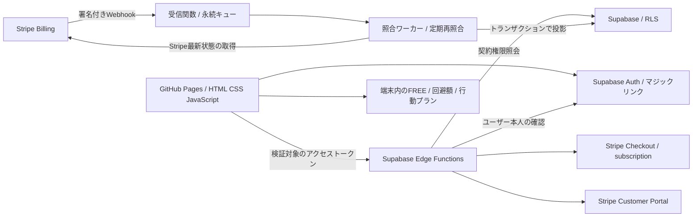

# ハズレの記憶 PLUS：月額契約・認証・権限設計

販売予定：月額300円（税込）、自動更新あり、いつでも解約可能。FREEは無料。旧一回払い設計を置き換える。販売・契約管理は未実装で、SQLは未適用。今回の変更は設計、SQL案、画面文言、テストのみ。実際のStripe/Supabase接続や公開は行わない。

## 構成と守る境界



認証の既存マジックリンク・将来のSMTP対応OTPは維持。ログインだけではPLUSを解放しない。利用者の衝動・成功・言葉・回避額・メモ・行動プランはサーバーへ送信せず、保存形式・キー・一括バックアップv1を変更しない。今のproviderのgetAccess()/subscribe()を将来のserver-providerへ置き換える。

GitHub Pagesには秘密を置けない。公開キーのみフロントへ配置し、service_role、Stripe秘密鍵、Webhook署名secretはEdge Functionsの秘密設定へ置く。ブラウザへ配る分析・計算コードを完全に秘匿することはできない。将来のPLUSサーバー処理・データはリクエストごとに本人と有効な契約期限を検証する。

## 契約・利用期限のルール

| 場面 | 契約情報と権限の扱い |
|---|---|
| 未ログイン | 契約有無は未確認。FREE利用可能 |
| 新規契約 | Checkout完了画面だけでは解放しない。対象月の支払済みinvoiceと契約を照合後に許可 |
| 更新成功 | invoiceの対象利用期間を確認して有効期限を延長 |
| 解約予約 | cancel_at_period_end=true。支払い済み期間末までPLUS、次回請求予定なし |
| 予約取消 | Portalの設定で許す場合のみ更新を再開。支払い済み期間は変えない |
| 期間終了 | サーバー時刻がvalid_until以上なら拒否。Webhookが遅れてactive行が残っても延長しない |
| 更新決済失敗 | 決済失敗と案内。既に支払い済みの期間は維持し、期限後はPLUS停止。無償猶予は設けない |
| 失敗後の回収成功 | 支払済みinvoiceの期間を再照合し、現在時刻を含む期間があれば再開 |
| 即時解約・unpaid・paused | 停止時点で権限停止。通常の利用者解約は期間末予約に統一 |
| 全額返金 | 対応invoiceの期間を無効化。他の有効な支払済み期間があればそれだけは維持 |
| 部分返金 | 今回の設計方針は対応期間を維持。販売前に規約・運用として確定する |
| 異議申立て | 対象契約を安全側に停止し、調査・解決後に再照合。自動で他契約を消さない |
| 再契約 | 同じAuth userとCustomerに新subscriptionを紐付ける。終了済み契約を上書きせず履歴を保持 |

返金額は成功した返金だけをStripeから再取得して集計する。pending/failed/canceledの返金要求を全額返金として扱わない。返金だけで継続契約が自動解約されるとは考えず、今後の請求も止める場合は別途解約処理を行う。

無償trial、クーポン、日割り価格変更、複数商品、手動請求は初版では提供しない。Stripe status=activeだけでも、Checkout成功URLでも権利を認めない。初版は固定月額Price・自動回収・支払済み対象期間の組み合わせで確認する。Stripeの月間隔を使い、30日を加算して期限を作らない。

権限の判定はサーバー時刻で `status=active AND valid_from <= now < valid_until`、かつ対応契約が停止対象でないこと。支払済み期間をまとめる際は隙間を埋めない。将来期間だけのinvoiceから現在の権利を作らない。複数履歴は現在を含む連続した有効期間を投影し、最長の終了日だけで過去からの権利を推測しない。

## テーブル・RLS案

未適用のSQL本体：[`../sql/subscription-entitlements.sql`](../sql/subscription-entitlements.sql)。新しいテストDB向けのレビュー案で、既存テーブルへの自動移行SQLではない。旧設計は提案のみだったが、適用先に同名テーブルが存在する場合は止めて別migrationをレビューする。既存権利を推測して変換しない。

| テーブル | 用途 |
|---|---|
| billing_private.customers | 検証済みAuth userとStripe Customerの一意対応、テスト/本番区分 |
| billing_private.subscriptions | Stripe契約、期間、解約予約、次回請求予定、停止、最新照合時刻 |
| billing_private.invoice_periods | 支払済みinvoiceごとの期間・支払額・返金額・状態 |
| billing_private.webhook_events | event.id一意、処理状態・再試行・処理lease。生の決済payloadを保存しない |
| public.plus_entitlements | 本人向けの最小契約概要、有効開始/終了、契約期間終了、次回請求予定、決済状態 |

全テーブルRLS有効。public.plus_entitlementsはauthenticatedにSELECTだけ許可し、auth.uid()=user_idの本人行のみ。INSERT/UPDATE/DELETEは禁止。内部billing_privateはData APIの公開schemaに追加せず、anon/authenticatedのschema/table権限を取り消す。service_roleのみ内部処理可能。将来の更新RPCは一般利用者のEXECUTEを取り消し、固定search_pathでサーバー専用にする。

service_roleはRLSを回避するためAPI自身もgetUser等でトークンを検証する。ブラウザ指定user_id、メール文字列、user_metadata、localStorageのPLUSフラグを信用しない。user_idはAuthで確定し、Customerは内部DBで決定。退会時は課金停止・保存義務・匿名化方針を確定後に専用処理を設け、Auth削除で課金履歴を連鎖削除しない。

## Checkout・Customer Portal

1. create-checkoutは本人認証、既存契約と未完了Checkoutの重複防止を実施。ユーザー単位のロック/購入要求IDとStripe idempotency keyを使う。再試行で別契約を作らない。
2. サーバーがJPY・月間隔・300円・税込設定の確認済みPrice ID、mode=subscription、quantity=1、Customer、成功/取消URLを選ぶ。初版ではtax_behavior=inclusiveの固定税込額を採用し、追加税で300円を超えないことをテストする。ブラウザの金額・商品・Customerを採用しない。
3. subscription metadataへサーバーでuser対応を設定し、WebhookではDB対応も照合。知らないCustomerやPriceを受けても権利を作らない。
4. create-portalも本人認証し、DBのCustomerだけにPortal sessionを生成する。他人のCustomer IDを受け取らない。return_urlは固定許可先。
5. Portalは支払方法変更・請求履歴・期間末解約を許可し、商品変更/即時解約の提供範囲を設定で確認する。解約画面で終了日時、次回更新停止、返金が自動ではないことを表示する。実装前に解約・返金条件を確定する。

次回請求日はStripeの請求周期・予定invoiceから得る「予定」であり、独自に1か月加算しない。解約予約・期限切れではnull。DB取得に失敗したら「確認できません」、正常取得で未定なら「未定」。契約期間終了日は対象PLUS subscription itemのperiod_endを採用する。Stripe APIの固定バージョンによりperiodの位置が異なるため、契約本体/対象itemのどちらにあるか実接続で確認する。日本時間で表示し、期限はUTC timestamptzで管理する。

## Webhookと整合性

対象例：checkout.session.completed / checkout.session.async_payment_succeeded / checkout.session.async_payment_failed、customer.subscription.created/updated/deleted、invoice.paid/payment_failed、charge.refunded、refund.updated、charge.dispute.created/closed。採用API版のイベント一覧とinvoice→支払い→返金の対応をテスト環境で検証する。通知そのものを権限付与の命令として扱わない。

- 未加工のリクエストbodyとStripe-Signatureを公式署名検証処理へ渡し、時刻許容を検証。Webhookには利用者JWTの代わりに署名が必要。署名不正は拒否する。
- livemode、Customer、Price、通貨、月間隔、invoice対象行と期間、請求・実支払状態をサーバーで確認する。支払失敗invoiceや非同期未確定決済では延長しない。APIバージョンを固定する。
- event.idを一意で永続キューへ保存してから2xx。同じIDのpending/failedイベントを「処理済み」と誤認せず再試行する。保存失敗は非2xx。内部詳細や秘密をログに出さない。
- ワーカーは期限付きleaseを取得し、Stripeの現在のsubscription・invoice・返金・異議状態を再取得する。event.createdの大小だけで巻き戻しを防げるとは考えない。
- 同じCustomer/userの照合を直列化し、古いワーカーの投影をfencing token/照合世代で拒否する。Stripe取得前から同じ照合leaseを持ち、更新トランザクションで所有権を再検証する。期限切れleaseのワーカーはcommit不可。
- 契約・invoice・権限の投影更新とイベントprocessed記録は1つのPostgresトランザクション。途中失敗はrollback、再試行可能にする。外部Stripe取得までDBトランザクションで原子的にはできないため、イベントの後続照合と定期ジョブで収束させる。
- Stripe API取得失敗は権利なしへ書き換えない。直前の確定期限を勝手に延長せず、APIは確認失敗を返す。未処理/failedの監視、再試行上限・運用通知を設ける。
- 定期照合でWebhook欠落、期間境界、Portal操作を回復。通常の権限APIでもDBの期限を毎回検証し、期限後activeを許可しない。返金/停止の反映遅延を完全ゼロとは保証しない。照合鮮度の上限を定義し、古すぎる場合は再照合または確認失敗にする。

## フロントの状態・認証後の再取得

| 状態 | 表示と操作 |
|---|---|
| signed-out / unknown | 未ログイン・契約未確認。FREEは利用可能 |
| checking | 契約確認中。FREEの衝動対処を妨げない |
| active | 有効な契約、利用期限、次回請求予定を表示 |
| cancel-scheduled | 解約予約済み、期間終了日時と次回更新なしを表示 |
| none / expired | サーバーで正常確認した未契約/期限切れ。FREEへ戻る |
| payment-failed / suspended | 決済失敗/停止を未契約と区別。残りの有効期間があればその期限まで利用可能 |
| error | 契約を確認できません。未契約と断定せず再試行。FREE・バックアップは維持 |

API応答例：status、allowed、validUntil、currentPeriodEnd、nextInvoiceAt、cancelAtPeriodEnd、paymentState、checkedAt。allowedはサーバーで計算。ログイン、起動、再読込、ユーザー切替、token更新、Checkout/Portalからの帰還、タブ復帰、期間境界で再取得する。成功URLのsession_idや状態を権利の証拠にしない。決済直後は確認中を表示し、上限付き再試行後に未反映の案内を出す。別端末でも同じAuth userならサーバー契約を復元するが、端末内記録は自動同期しない。

ログアウト時にメモリ内権限を破棄。非同期応答は要求世代とuser_idを照合し、古い応答で権利を復活させない。契約権限・デモ状態・認証情報はバックアップに含めず、JSON編集で契約を作れない。通信失敗時の永続allowed=trueを信用しない。本番ではデモ経路を無効にし、設定不足でデモへフォールバックしない。

## 解約・データ管理

期限後もFREEの全機能、言葉、記録、設定、5秒演出を維持する。PLUSの分析・編集は有効な契約期間だけ許可する設計だが、既存の回避額・行動プランを削除しない。FREE/PLUS一括バックアップ・復元・個別データの書き出し/削除は契約権限と分離する。PLUSの個別管理画面が非表示でも設定画面の一括バックアップは利用できる。再契約時は端末内の既存データを再利用できる。これは今後の本番provider実装方針であり、今回のローカルデモの操作は変更しない。

## 設定・実装順・未検証事項

公開設定：Supabase Project URL、publishable key、Auth戻り先、環境モード。現在は接続無効・値空欄を維持する。
サーバー秘密設定：SUPABASE_URL、サーバー専用キー、STRIPE_SECRET_KEY、STRIPE_WEBHOOK_SECRET。
サーバー一般設定：STRIPE_PRICE_ID_MONTHLY、固定API版、PRODUCT_CODE、承認済みAPP_BASE_URL/CORS、テスト本番区分、照合鮮度と再試行設定。実値は推測しない。
Stripe Dashboard：月額300円JPYの税込Price、subscription Checkout、Portalの期間末解約/支払方法変更、Webhook、再請求ルール。Supabase：RLS案、非公開schema、サーバー専用RPC、処理キュー/定期ジョブ。SMTP・Redirect設定は既存認証手順を参照する。

次段階は、この設計のレビュー → ローカルserver-provider/照合ロジックのモックテスト → 承認後のテストDB SQL適用と二人でのRLS検証 → Stripeテストモードで契約/更新/失敗/予約解約/返金/再契約・順序逆転を検証 → 規約・サポート・運用監視 → 別途承認後の本番設定。mainへのpushや公開、実決済の有効化は今回行わない。

初回設計時は静的確認のみだったが、セキュリティレビューで隔離したローカルPostgreSQL上のSQL実行・RLS/ACL試験を追加した。Supabase実環境のJWT/HTTP/RLS、Stripeイベント/APIの版別応答、メール・決済・Portal・実契約の復元、競合制御・worker/RPCは引き続き未実装/未検証。

料金は契約時に公式料金を確認する。Stripe決済手数料に加えてStripe Billingの利用料、Supabase、SMTP、監視等が発生し得る。300円がそのまま収益ではない。月額料金と解約・返金条件、事業者情報・特商法表示・プライバシーを販売前に整える。

公式確認先（今回、最新の設定画面・価格を実接続で確認していない）：
- https://docs.stripe.com/billing/subscriptions/overview
- https://docs.stripe.com/payments/checkout/build-subscriptions
- https://docs.stripe.com/customer-management
- https://docs.stripe.com/webhooks
- https://supabase.com/docs/guides/database/postgres/row-level-security
- https://stripe.com/jp/pricing
- https://supabase.com/pricing

## 次段階のCodexへの指示案

```text
月額300円（税込）PLUS契約設計に沿い、まずserver-providerと契約照合ロジックをモックで実装してください。
有効期間だけPLUSを許可し、解約予約・支払失敗・期限切れ・全額/部分返金・再契約・通信失敗を区別してください。
Webhook重複・順序逆転・lease失効・遅い認証応答をテストしてください。
FREE、端末内データ、一括バックアップ、5秒演出を維持し、本番でデモを許可しないでください。
実DB適用、Stripe接続、commit/push、公開は別途承認まで行わず、未検証事項を報告してください。
```

## 実DB適用前セキュリティレビューによる補強

詳細な指摘・検証手順・判定は [subscription-security-review.md](subscription-security-review.md) を参照する。初期SQLは再実行を無害な成功として扱わず、既存schema/table/functionがあれば最初に拒否する。全体をBEGIN/COMMITで実行し、エラー時はROLLBACKする。クライアントのCREATE、BYPASSRLS・管理ロール継承があれば適用を停止する。管理者/所有者としてのみ適用する。

追加した2関数はともにSECURITY INVOKER・search_path空欄で、SECURITY DEFINER関数はない。get_plus_access()はauthenticated本人のRLS対象行だけを読む。anon/PUBLICのEXECUTEを取り消し、返金保護trigger関数はサーバー専用とする。通常workerはinvoice台帳をDELETE/TRUNCATEできず、支払済みinvoiceの識別子・期間・支払額は更新不可。成功返金額の減少と全額返金/void状態の巻き戻しをtriggerで拒否する。正規の訂正や保存期間終了に伴う削除は管理者による監査済み手順へ分離する。

権限APIの最終許可はget_plus_access()のallowedを基準にする。生のstatus=activeを判定に使わない。関数はDB時刻で期限と開始時刻を確認し、未来の期間はnot_started、期限終了はexpired、verified_atが未来または5分より古い場合はerror/allowed=falseとする。クライアント時計を期限延長の根拠にしない。5分は初期の照合鮮度上限であり、変更時はSQL・運用設計を同時にレビューする。欠落行のnoneは照会成功時の権利なしを表すが、照合処理の失敗・未完了をAPIが把握している場合は、その状態を優先して確認失敗/確認中を返す。SQL関数はStripeの状態やキューの失敗まで確認するものではない。

サーバーAPIは本人を検証したJWTでこのread-only RPCを呼ぶか、同じ条件を信頼できるサーバー処理で検証する。通常の権限照会にservice_roleを使って本人行のフィルターを忘れない。PLUSのサーバー処理が将来できた場合も、この確認を毎リクエストに適用する。

Webhookの世代・lease列は排他制御そのものではない。次段階のサーバー専用RPCは、照合世代、owner、lease有効期限をWHERE条件に持つCASと行ロックで更新を確定し、失効したworkerを拒否する。返金triggerだけでは権限投影やDELETE可能な別テーブルを保護しきれない。invoiceの最新状態から投影する処理、停止状態の伝播、イベントprocessed記録を同一DBトランザクションに実装するまでは、本番の契約権限基盤が完成したとは扱わない。

検証SQLは `tests/sql/subscription-security.sql`。ROLLBACKでfixtureを除去する、使い捨てテストDB専用の管理者スクリプト。ローカルでのみ使うAuth模擬環境は `tests/sql/local-supabase-fixture.sql` で、Supabase実DBには適用しない。Dockerがある環境では `node scripts/test-subscription-sql.cjs` で隔離PostgreSQLの再現テストを実行できる。実際のSupabase/Auth/PostgRESTの設定は別途検証が必要。

空で未使用のテストschemaの取り消しには `sql/subscription-entitlements-rollback.sql` を用意した。データが1件でもあれば拒否し、CASCADEを使わない。データ付きDBは削除で戻さず、事前バックアップの復元計画または前進migrationをレビューする。現段階では使い捨てSupabaseテストDBへの検証適用のみ条件付きで可能、本番DBへの適用・販売開始は不可とする。
